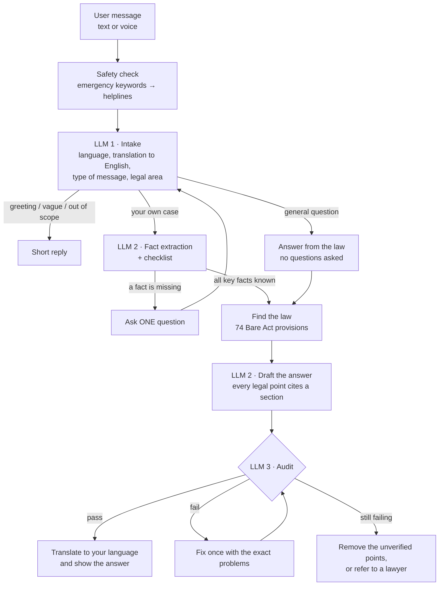

# NyayaMitra (न्यायमित्र) — AI Legal Assistant for India

**Legal help for ordinary people, in English, हिंदी or Hinglish, by text or voice.**

You describe your problem in your own words. NyayaMitra asks only the questions it still needs, then explains
where you stand, what you can do and by when, with every legal point cited to an Indian Bare Act and checked
before you see it. If it cannot verify an answer, it says so and points you to a lawyer or free legal aid.


> **Note:** NyayaMitra gives legal *information*, not legal advice. It does not replace an advocate.

---

## Contents

- [Example](#example)
- [Quick start](#quick-start)
- [How it works](#how-it-works)
- [Why it doesn't make up laws](#why-it-doesnt-make-up-laws)
- [What it covers](#what-it-covers)
- [Test results](#test-results)
- [Cost](#cost)
- [Configuration](#configuration)
- [Project structure](#project-structure)
- [Limitations](#limitations)

---

## Example

*A shortened conversation. Full transcripts are in [`outputs/`](outputs/).*

> **You:** My landlord in Pune is not returning my ₹40,000 security deposit. I vacated on 15 August.
>
> **NyayaMitra:** Has the landlord given any reason for keeping the deposit, such as damage or unpaid rent?
>
> **You:** No reason at all.
>
> **NyayaMitra:** Do you have the rent agreement or receipts for the deposit? Anything else I should know?
>
> **You:** I have the agreement.
>
> **NyayaMitra:**
> **Where you stand legally**: the landlord must refund the deposit when taking back vacant possession,
> after valid deductions *(Section 11, Model Tenancy Act, 2021; this applies only in states that have adopted it)* …
> **Your options** · **Time limits** · **What to do next** · **Draft legal notice** · **When to involve a lawyer** · **Sources**

The same conversation works in Hindi (*"मेरा मकान मालिक डिपॉजिट नहीं लौटा रहा…"*) or Hinglish
(*"mera landlord deposit wapas nahi de raha…"*). The answer comes back in the same language.

**What every answer contains**

| Section | What it tells you |
|---|---|
| Understanding your situation | your facts, as the system understood them |
| Where you stand legally | the law that applies, with its source |
| Your options | what you can do and where to go (court, commission, police, authority) |
| Time limits | deadlines that apply to you |
| What to do next | practical steps for the next week or two |
| Keep these ready | the documents and proof you need |
| Draft | a legal notice or complaint you can edit and use |
| When to involve a lawyer | when to get professional help, and free legal aid (NALSA 15100) |
| Sources | the exact Bare Act sections used |

---

## Quick start

**1. Install**

```bash
git clone <this-repo-url>
cd nyayamitra
pip install -r requirements.txt
```

**2. Add API keys.** The free tiers are enough.

```bash
cp .env.example .env
```

Open `.env` and fill in:

| Key | Needed for | Get it from |
|---|---|---|
| `GROQ_API_KEY` | intake model and auditor | console.groq.com |
| `GEMINI_API_KEY` | drafting and translation | aistudio.google.com |
| `SARVAM_API_KEY` | voice input (optional) | dashboard.sarvam.ai |

**3. Run**

```bash
streamlit run app.py
```

Open http://localhost:8501. Run the command from the project folder so the light theme loads.
Restart the app whenever you change `.env` or the code.

---

## How it works



### In plain words

1. **Understand.** LLM 1 detects your language, translates your message to English, and decides what it is:
   your own case, a general question about the law, a greeting, or something out of scope.
2. **Ask only what's missing.** LLM 2 fills a checklist from what you've said. It records only facts you actually
   stated, never guesses. Then it asks **one question at a time** about the most important missing fact.
3. **Find the law.** It searches a curated set of 74 Indian Bare Act provisions. It picks the right criminal
   law by date: IPC before 1 July 2024, BNS after.
4. **Draft.** LLM 2 writes the answer in English. Every legal point must cite the provision it comes from.
5. **Audit.** LLM 3, a different model from the drafter, checks the draft twice: once with exact code checks,
   once by reading each point against its source.
6. **Answer.** The verified answer is translated into your language. The citations, the "when to see a lawyer"
   advice and the disclaimer are added by code, not by the AI.

<details>
<summary><b>More detail: how the questions work</b></summary>

- **Checklists depend on the type of problem.** A deposit dispute, an eviction and a builder delay each have
  their own critical facts. A fact counts as critical only if it changes the court, the deadline, the law that
  applies, eligibility for a remedy, or your safety.
- **Nothing is guessed.** From *"my boss is not giving me money"* it does not assume you still work there or
  what's unpaid. It asks. Vague values like "probably…" are rejected in code.
- **Facts you already gave are never asked again.** From *"my wife has left me"* it already knows the
  relationship.
- **Useful information is kept** even when it doesn't answer the question asked
  (*"I don't remember the date, but he threatened me again"*).
- **Unanswered questions are asked again,** a limited number of times. A question is marked "not provided" only
  when you actually say you don't know or won't say.
- **Safety first.** For threats, assault and domestic violence it asks "Are you safe right now?" before
  anything else, and shows helplines (112, 181, 1930, 14416) as soon as danger is mentioned.
- **A new problem in a follow-up** (*"he also threatened me"*) gets its own questions before the answer.
- **A general question** (*"can I defend myself if a thief comes?"*) is answered straight from the law, with no
  intake questions.

</details>

---

## Why it doesn't make up laws

AI models often invent sections, penalties and court cases. NyayaMitra is built to stop that:

| Safeguard | How |
|---|---|
| Only retrieved law | The drafter sees only the provisions found for this case and must cite their IDs. It never cites case law. |
| Code checks every citation | Every cited ID must exist, and every section number and Act name mentioned must be in the retrieved law. |
| Code checks every number | Each amount, deadline and percentage must appear in the cited section or in your own facts. "30 days" can't be invented. |
| A second model checks the meaning | LLM 3, from a different provider, reads each point against its source. |
| One fix, then stop | A failed draft gets one correction. If points still fail, they are removed. If nothing reliable remains, the system refers you to a lawyer instead of guessing. |
| Fails safe | If the audit itself can't run, the answer is not shown as verified. |

You can see all of this in the app's **Case inspector** panel: the facts collected, the law retrieved, the audit
result, and the model calls used.

---

## What it covers

| Area | Covered | Not covered |
|---|---|---|
| Consumer | defective goods, poor service, e-commerce refunds, which commission, fees, 2-year limit | — |
| Property | security deposit, eviction notice, lock-outs, builder delay (RERA) | state rent-control Acts |
| Employment | unpaid salary (Code on Wages 2019), termination, gratuity | — |
| Contracts | breach, compensation, arbitration clause, cheque bounce | — |
| Criminal | cheating, threats, assault, theft, trespass, self-defence, online fraud, FIR (BNS / IPC by date) | bail, trial strategy |
| Family | Hindu Marriage Act: spouse left, divorce, maintenance, custody, domestic violence | Muslim / Christian personal law, Special Marriage Act |
| Elsewhere | — | tax, immigration, company and IP law, court representation |

---

## Test results

11 test conversations are run end to end against the real models, each played by a simulated user who
answers the system's questions. Full transcripts are in [`outputs/`](outputs/).

| # | Case | Language | Questions | Result |
|---|---|---|---|---|
| 01 | Deposit not returned | English | 1 | Model Tenancy Act, with its state caveat; draft legal notice |
| 02 | Wife has left | Hinglish | 5 | relationship never asked; restitution of conjugal rights |
| 03 | Broken TV from Amazon | English | 0 | correct consumer commission by amount |
| 04 | Fired, salary unpaid | Hindi | 2 | Code on Wages; draft wage claim in Hindi |
| 05 | Landlord lock-out and threat | English | 5 | property and criminal law together; 112 helpline |
| 06 | Job fraud in March 2024 | English | 3 | IPC applied, not BNS (before July 2024) |
| 07 | "I am in danger", then abuse | English | 5 | helplines first, then a domestic violence case |
| 08 | Income tax question | English | 0 | politely declined as out of scope |
| 09 | Asks about a fake "Section 420B" | English | 1 | says it couldn't find it; explains the real remedy |
| 10 | Off-topic replies | English | 4 | question asked again, then moved on |
| 11 | New problem raised in a follow-up | English | 3 | asked about the new problem before answering |

**All 10 cases that reached an answer passed the audit** (7 on the first draft, 3 after one correction).
None were refused.

```bash
python3 -m pytest -q tests        # 47 offline tests, no API calls
python3 scripts/run_cases.py      # re-run the 11 live conversations into outputs/
```

---

## Cost

Measured over the test conversations:

| | Per conversation |
|---|---|
| Model calls | 8 – 21 (more questions = more calls) |
| Tokens | about 21,600 in and 4,200 out |
| Cost on free tiers | ₹0 |
| Cost on paid small models (assumed $0.10 / $0.40 per million tokens, input / output) | about $0.004, or roughly $400 per 100,000 conversations |

The safety check, checklist, search, rules and code-based audit cost nothing.

<details>
<summary><b>Scaling to real-world use</b></summary>

- **Knowledge base:** move from 74 summaries to the full Bare Acts plus state rules, keeping the same citation
  format. The auditor doesn't change.
- **Lower cost:** answer greetings with a rule, cache the repeated instructions, and send the extractor less
  context per turn.
- **Human checks:**
  - Lawyers review the knowledge base.
  - Every refusal goes to a legal-aid queue.
  - A sample of answers is reviewed every week.

</details>

---

## Configuration

Everything is set in `.env`.

**Swap a model in one line.** Any OpenAI-compatible provider can be added in `llm/client.py`.

```ini
LLM1_MODEL=groq:qwen/qwen3.8-27b          # intake and question checking
LLM2_MODEL=gemini:gemini-3.5-flash-lite   # facts, questions, drafting
LLM3_MODEL=groq:qwen/qwen3.8-27b          # auditor (keep a different provider from LLM2)
TRANSLATE_MODEL=gemini:gemini-3.5-flash-lite
```

If a provider is down or rate-limited, the next one in `FALLBACK_MODELS` is used automatically. The Usage
tab shows which model answered.

**Limits**

| Setting | Default | Meaning |
|---|---|---|
| `MAX_TOTAL_CLARIFICATIONS` | 4 | questions per conversation |
| `MAX_CLARIFICATION_RETRIES` | 1 | times an unanswered question is asked again |
| `MAX_RETRIEVAL_CALLS` | 2 | law searches per conversation |
| `MAX_GROUNDING_RETRIES` | 1 | corrections after a failed audit |

---

## Project structure

```
app.py                     Streamlit interface
orchestrator/pipeline.py   conversation flow, limits, audit retry, translation
orchestrator/render.py     builds the final answer (citations, lawyer advice, disclaimer)
llm/client.py              one client for all model providers, with fallback
llm/llm1_classifier.py     LLM 1: language, message type, legal area, answer checking
llm/llm2_agent.py          LLM 2: facts, next question, search queries, drafting, translation
llm/llm3_verifier.py       LLM 3: meaning check and final verdict
verification/checks.py     code checks: citations, sections, Acts, numbers
checklists/                problem types, checklists and questions in 3 languages
kb/provisions.json         74 Bare Act provisions (plain-language summaries)
kb/retriever.py            search over the provisions
rules/                     safety keywords, helplines, dates, court by amount, IPC vs BNS
persistence/db.py          saves conversations (SQLite)
voice/transcriber.py       speech-to-text (Sarvam)
tests/                     offline tests and the 11 simulated users
scripts/run_cases.py       runs the simulated users and writes outputs/
outputs/                   raw transcripts from the test runs
```

---

## Limitations

- **The knowledge base is a summary.** The 74 provisions are plain-language summaries written from
  indiacode.nic.in, not the official text. The uncertain figures were checked against legal commentary.
- **The auditor can miss things.** The code checks are exact, but the meaning check is done by a model.
- **Not every part is checked for meaning.** The draft notice and the "Assumptions" list get only the code
  checks.
- **Safety keywords miss some phrasings,** such as *"mujhe darr lag raha hai"* or *"koi peecha kar raha hai"*.
  There is also no stalking provision yet (BNS s.78).
- **One question per turn makes some intakes long:** family cases can take 5 questions.
- **The extractor is strict on purpose,** so it sometimes asks for something you only implied (for example the
  date after "last night").
- **Free tiers are rate-limited.** When that happens the system switches provider. It may briefly use the same
  provider for drafting and auditing.

---

<sub>Built for the Kuku AI Generalist assignment (Problem 2: Build an AI Lawyer). Legal information only, not
legal advice. For free legal aid in India, call NALSA at 15100.</sub>
